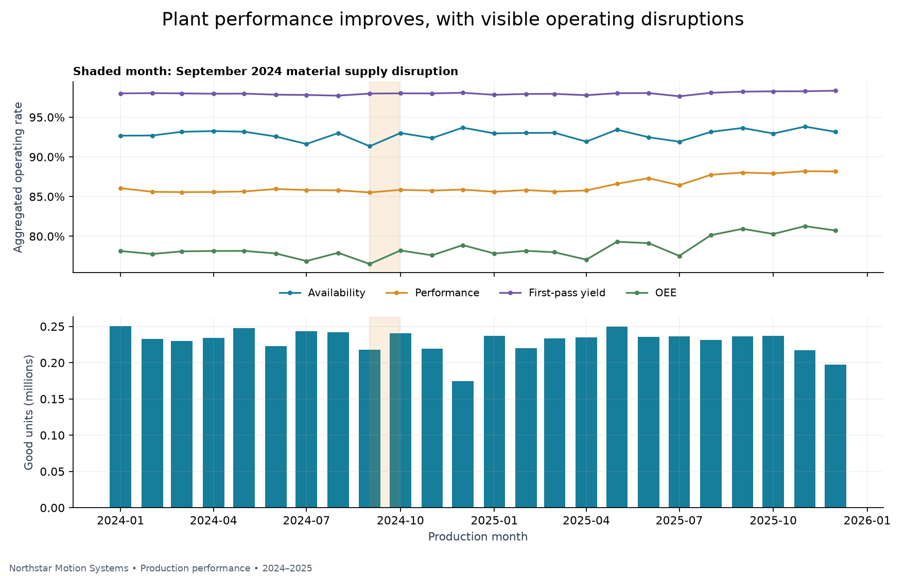
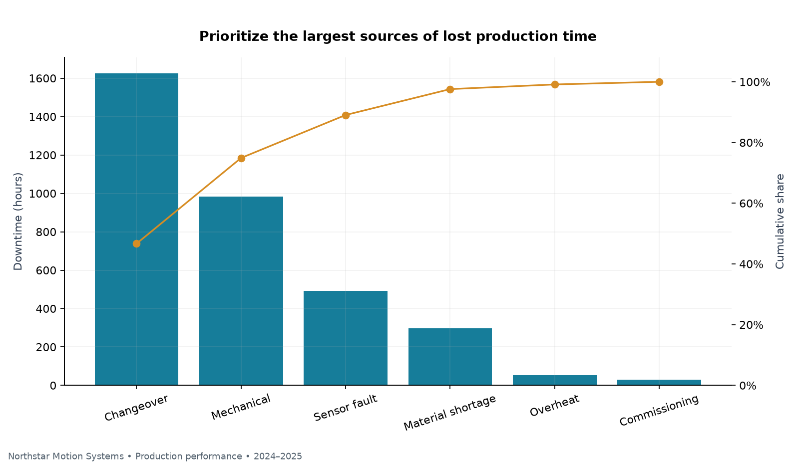
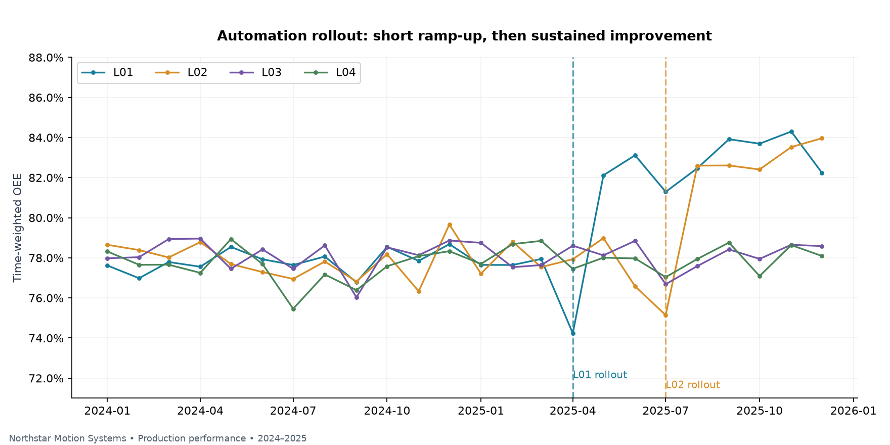
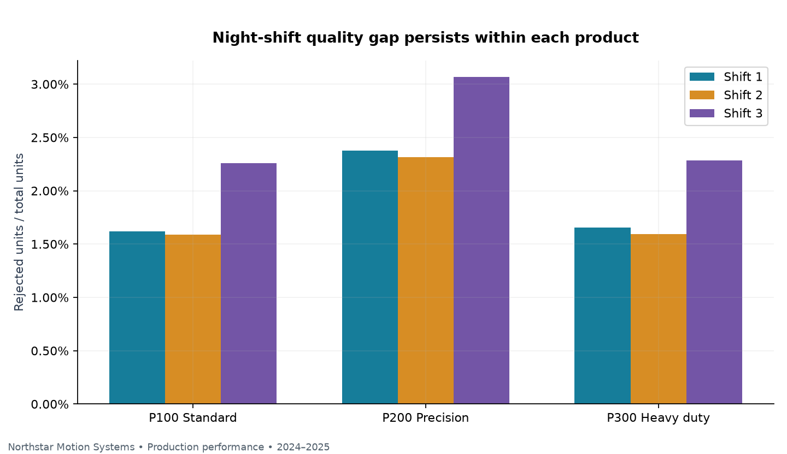
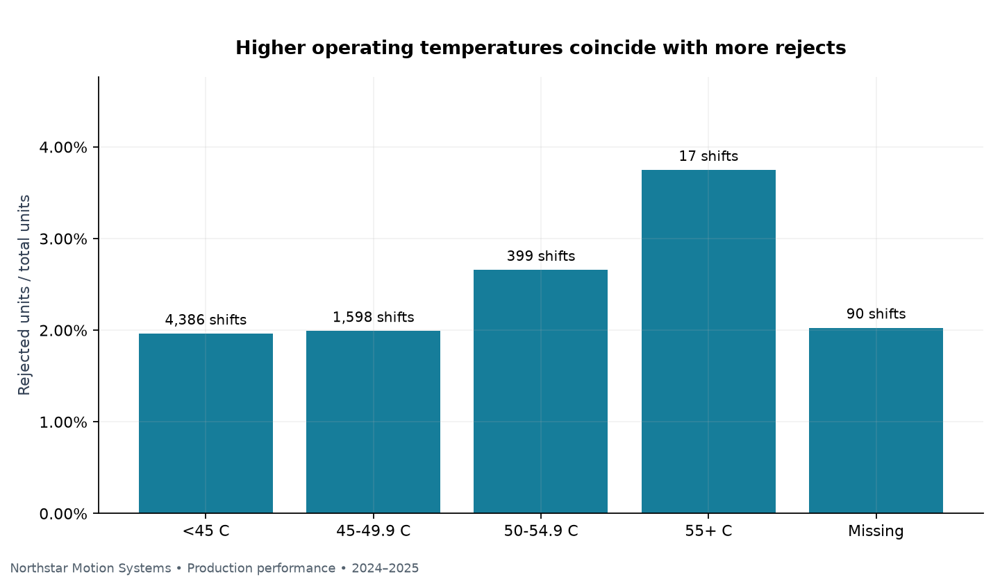
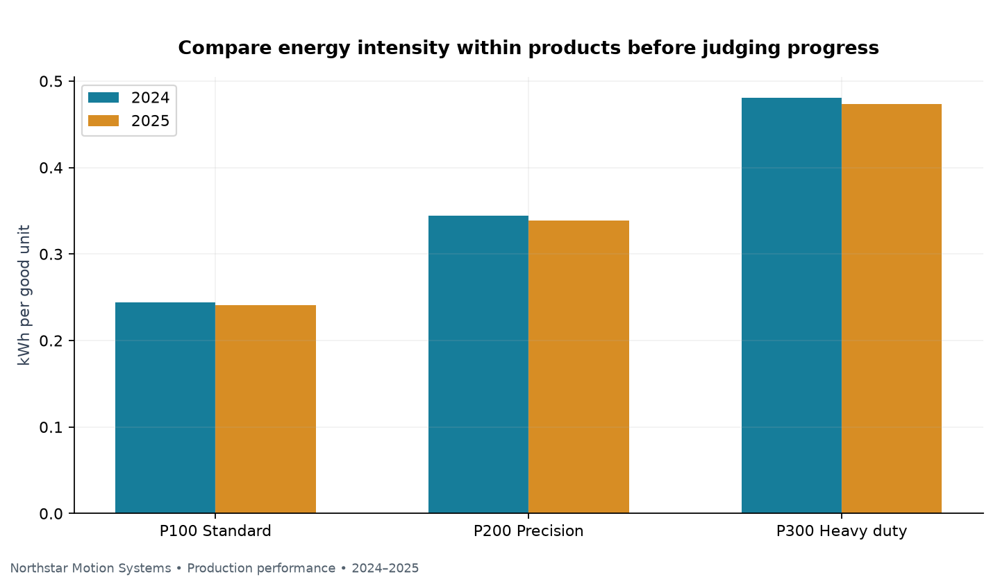

# Northstar Motion Systems: Manufacturing & Automation Analytics

**A SQL and Python portfolio case study for Northstar Motion Systems, a fictional valve actuator manufacturer, using a synthetic dataset.**

I built a reproducible analytics pipeline to evaluate production performance across Northstar Motion Systems' four automated assembly lines. The project connects messy manufacturing execution system (MES) exports to operating metrics, exploratory charts and practical improvement priorities.

## Business problem

Northstar Motion Systems' plant operations manager wants to understand where production time is lost and whether the initial automation rollout merits a controlled expansion. Two lines receive upgrades during 2025; two remain comparison lines. The analysis asks:

- What drives changes in overall equipment effectiveness (OEE)?
- Which downtime categories deserve attention first?
- How do treated and untreated lines change across comparable calendar periods?
- Does the night-shift reject gap persist within the same product?
- How do temperature and product mix affect the interpretation of quality and energy metrics?

## Key findings

- **Overall OEE: 78.5%**, calculated from ideal good-production minutes divided by planned production minutes across all valid shifts.
- **Changeover and mechanical stops account for 74.9% of recorded downtime.** They are the largest investigation priorities by lost time, although not all of that time is recoverable.
- **Treated-line OEE rises from 77.79% to 83.39%.** Control-line OEE changes from 78.19% to 78.23%. The descriptive difference-in-differences is **5.55 percentage points** using January–March versus September–November 2025.
- **Night-shift rejects are higher within all three products.** This supports investigating process conditions and work standards while recognizing that shift assignment and equipment condition are not controlled experimentally.
- **Hotter equipment readings coincide with higher rejects:** 1.96% below 45°C versus 3.75% at 55°C and above. Wear and seasonality are possible confounders.

| Year | Valid shifts | Good units | OEE | Reject rate | kWh / good unit |
|---|---:|---:|---:|---:|---:|
| 2024 | 3,186 | 2,755,414 | 77.8% | 2.06% | 0.296 |
| 2025 | 3,304 | 2,765,715 | 79.1% | 1.98% | 0.306 |

Annual output also reflects the operating calendar and a larger precision-product mix in 2025. An output change alone is not an efficiency measure.

## Data and scope

- **Period:** January 2024–December 2025; four production lines and three products.
- **Schedule:** three weekday shifts, selected Saturday shifts, no Sunday production and specified holiday shutdowns.
- **Production grain:** one scheduled date × line × shift, producing one product.
- **Raw production:** 6,586 rows, including 70 older export copies.
- **Canonical schedule:** 6,516 shifts before business-rule validation.
- **Analysis population:** 6,490 shifts; 26 invalid shifts quarantined (0.40% of scheduled shifts).
- **Raw stop events:** 11,583; 11,540 retained after excluding 43 events attached to invalid production shifts.
- **Missing observations:** 90 temperature and 45 vibration readings retained as nulls.

The operating history covers equipment wear, monthly maintenance, variable stop durations, summer conditions, a September 2024 material disruption, product-mix changes and commissioning disruption followed by gradual automation improvement.

| File | Grain / purpose |
|---|---|
| [production_shifts.csv](data/raw/production_shifts.csv) | Raw shift exports: 15 source columns |
| [downtime_events.csv](data/raw/downtime_events.csv) | Individual stop episodes: 4 columns |
| [lines.csv](data/raw/lines.csv) | Line master and upgrade dates: 6 columns |
| [products.csv](data/raw/products.csv) | Product master, ideal cycles and assumed scrap costs: 4 columns |

Read the [full data dictionary](docs/DATA_DICTIONARY.md) for every column, unit, key and derived field. The [methodology](docs/METHODOLOGY.md) documents the generator, data problems, analytical design and limitations.

## Technical workflow

`MES exports → raw SQLite tables → SQL standardization and quarantine → KPI tables/views → Python EDA → README findings`

**Stack:** Python 3.12, SQLite (Python standard library), pandas, NumPy and Matplotlib. No server, credentials or proprietary data are required.

### 1. Generate realistic source data

[generate_data.py](src/generate_data.py) uses seed 42. Production volume depends on runtime, product/line ideal cycle and a noisy performance driver. Reject counts are binomial draws influenced by product, shift, wear, heat and automation maturity. Event durations reconcile to downtime, and good plus rejected units reconciles to total output before deliberate corruptions are injected.

Raw exports include inconsistent identifier casing, surrounding spaces, missing sensor readings, duplicates, negative counts, impossible dates and downtime beyond planned time. The [generation manifest](data/generation_manifest.json) records the expected counts.

### 2. Clean and transform with SQL

[01_clean_transform.sql](sql/01_clean_transform.sql) contains the full executable SQLite workflow. [build_database.py](src/build_database.py) loads the CSV strings, checks numeric syntax, executes SQL and exports the resulting tables. It:

1. Ranks versions by `shift_id`, newest export first, with a stable source-row tie breaker.
2. Trims and uppercases identifiers; converts measures to numeric types.
3. Validates real calendar dates, known dimensions, shift codes, time bounds, counts and cycle standards.
4. Saves invalid latest records in `rejected_shifts` with a reason rather than silently deleting or repairing them.
5. Retains null sensor readings and adds missingness flags.
6. Derives runtime, ideal productive minutes, OEE components, energy intensity and scrap cost.
7. Cleans events separately and creates monthly KPI views without multiplying production through event joins.

Example deduplication pattern from the SQL:

```sql
ROW_NUMBER() OVER (
    PARTITION BY TRIM(shift_id)
    ORDER BY exported_at DESC, source_row DESC
) AS export_rank
```

Example aggregate KPI query (after running the pipeline):

```sql
SELECT
    SUBSTR(production_date, 1, 7) AS month,
    SUM(runtime_minutes) / SUM(planned_minutes) AS availability,
    SUM(ideal_total_minutes) / SUM(runtime_minutes) AS performance,
    SUM(good_units) * 1.0 / SUM(total_units) AS first_pass_yield,
    SUM(ideal_good_minutes) / SUM(planned_minutes) AS oee,
    SUM(energy_kwh) / SUM(good_units) AS kwh_per_good_unit
FROM clean_shifts
GROUP BY 1
ORDER BY 1;
```

At shift grain, OEE = availability × performance × quality. At plant grain with mixed ideal cycles, OEE is `SUM(good_units × ideal_cycle_sec / 60) / SUM(planned_minutes)`. The aggregate factor decomposition uses **ideal-time-weighted quality**, while ordinary unit yield remains a separate metric. Arithmetic averages of shift percentages would use the wrong weighting.

Planned production time excludes breaks and scheduled maintenance; changeovers remain a loss inside planned production time. Definitions follow [Vorne's OEE calculation guide](https://www.oee.com/calculating-oee/).

### 3. Analyze with SQL and Python

[02_analysis.sql](sql/02_analysis.sql) contains seven queries covering monthly KPIs, downtime Pareto, shift/product quality, automation comparison, temperature bands, energy intensity and quarantine reasons. Executed results are saved as `data/processed/analysis_01.csv` through `analysis_07.csv`.

[eda.py](src/eda.py) reads SQL outputs and creates six charts using pandas and Matplotlib. Energy-year aggregation is calculated in Python from clean shift numerators and denominators; core KPI definitions are shared with SQL.

### Plant performance and production



The shaded month contains the September 2024 supply disruption. Operating rates help distinguish loss of availability from changes in scheduled production and product mix. Unit yield is shown for quality interpretation and is not used as the aggregate OEE decomposition factor.

### Downtime priorities



Changeovers are routine but consume the most cumulative stop time. Mechanical events are less frequent and more variable. A useful next step is to separate necessary setup work from avoidable adjustment and waiting time, then examine mechanical events by asset and failure mode.

### Automation rollout



The rollout includes an initial commissioning penalty followed by a learning curve. Both upgraded lines are mature during the September–November comparison window. The 5.55-point difference-in-differences is descriptive: four lines, nonrandom assignment, seasonal conditions and changing mix prevent a causal interpretation.

### Quality by product and shift



| Product | Shift 1 reject rate | Shift 2 reject rate | Shift 3 reject rate |
|---|---:|---:|---:|
| P100 | 1.62% | 1.59% | 2.26% |
| P200 | 2.38% | 2.31% | 3.07% |
| P300 | 1.66% | 1.60% | 2.28% |

Product stratification prevents a different precision-product mix from fully explaining the shift gap. It does not adjust for line condition, staffing or other unobserved differences.

### Temperature and quality



Missing temperatures remain visible as their own category. The hottest band contains only 17 shifts, so its estimate has limited support. The pattern suggests an investigation of cooling and equipment condition; it does not isolate a causal heat effect.

### Energy intensity



Slower-cycle products naturally consume more electricity per unit. At Northstar Motion Systems, intensity falls within each product in 2025 while plant-wide intensity rises from 0.296 to 0.306 kWh per good unit as mix shifts toward the slower precision product. Product-level comparisons are more informative than a plant-wide average alone; line mix and idle losses still affect the result. Vibration is included for further exploration but is not presented as a validated predictive-maintenance model.

## Recommended next actions

1. **Study changeovers:** collect timestamped setup steps and pilot a standardized setup procedure on one line. Track changeover minutes per setup alongside quality after restart.
2. **Investigate mechanical downtime:** add asset IDs, failure modes and maintenance work orders. Prioritize total lost minutes and repeated failures rather than event count alone.
3. **Audit night-shift process conditions:** compare the same line, product and maintenance age before testing changes to training, handoffs or operating settings.
4. **Validate automation expansion:** use a prospective pilot with comparable controls, commissioning windows and product/shift adjustments. Collect investment costs and contribution margins before presenting ROI.
5. **Investigate temperature and energy losses:** review cooling, wear and idle power using comparable product runs. Keep quality and throughput as guardrails.

These are proposed investigation and pilot steps. The project does not claim realized savings, recovered capacity or investment payback.

## Reproduce the project

Use Python 3.12. From the repository root, create and activate an environment:

```powershell
# Windows PowerShell
py -3.12 -m venv .venv
.venv\Scripts\Activate.ps1
python -m pip install -r requirements.txt
python run_project.py
```

```bash
# macOS / Linux
python3.12 -m venv .venv
source .venv/bin/activate
python -m pip install -r requirements.txt
python run_project.py
```

The pipeline regenerates the four raw CSVs, builds `data/manufacturing.db`, runs validation, exports clean data and query results, creates six figures, and refreshes this README from computed results. Generated project outputs are replaced on rerun; custom source edits should be saved separately. The SQLite database is ignored by Git because it is reproducible. The raw CSVs, processed CSVs and figures are included for immediate review.

To rerun individual stages after activating the environment:

```bash
python src/generate_data.py
python src/build_database.py
python src/eda.py
python src/write_readme.py
```

Open `data/manufacturing.db` in any SQLite client to run the analysis SQL interactively. SQL uses SQLite syntax, including `DATE()`, `SUBSTR()` and window functions; other SQL dialects need small date-function changes.

## Validation and limitations

The pipeline checks expected record counts, duplicate removal, quarantine coverage, dimension uniqueness, count balance, time balance, event-to-shift reconciliation, missingness counts, valid OEE bounds, shift-level OEE factor identity and aggregate factor identity. All checks must pass before the report is generated. See [validation.json](reports/validation.json) for the executed audit and [methodology](docs/METHODOLOGY.md) for assumptions and comparison design.

The dataset covers one product per shift and does not include detailed defect subtypes, rework recovery, customer orders, labor data or event timestamps. Sensor readings are shift averages, which can hide short-lived temperature and vibration spikes. These limits restrict conclusions about root causes, failure prediction and financial ROI.

## Repository structure

```text
data/
  raw/                    # Four source CSVs
  processed/              # Clean tables, KPI exports and seven query results
  generation_manifest.json
docs/
  DATA_DICTIONARY.md
  METHODOLOGY.md
reports/
  figures/                # Six PNG figures embedded above
  validation.json
sql/
  01_clean_transform.sql
  02_analysis.sql
src/
  generate_data.py
  build_database.py
  eda.py
  write_readme.py
requirements.txt
run_project.py
README.md
```

## Skills demonstrated

Relational data modeling, reproducible data generation, SQL CTEs and window functions, defensive data validation, auditable quarantine, dimensional joins, denominator-aware manufacturing KPIs, Python visualization, confounding-aware comparisons and operational communication.
